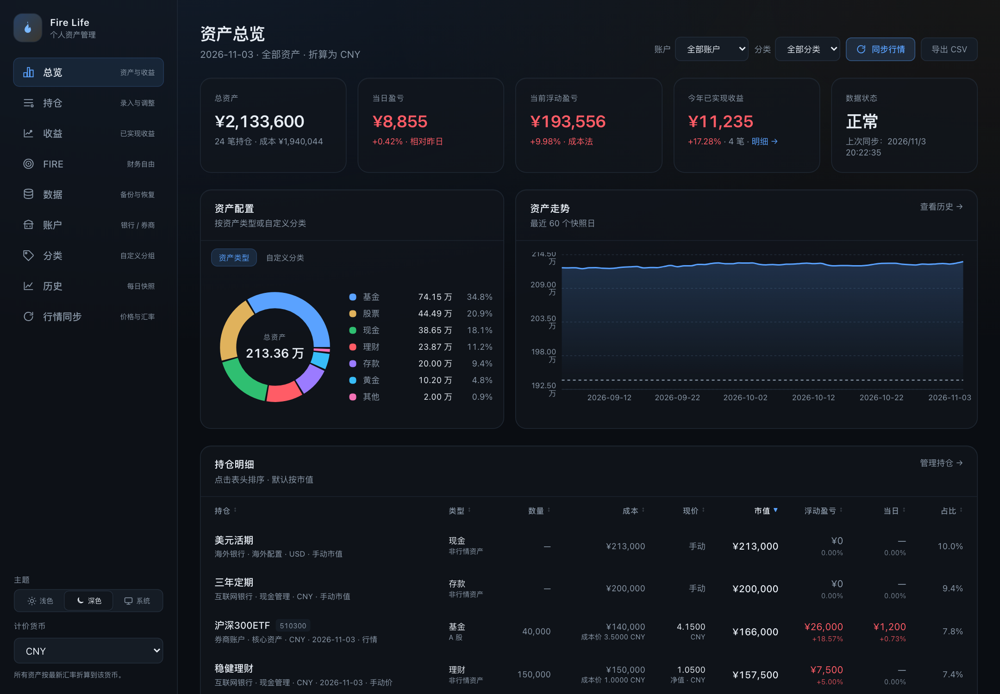
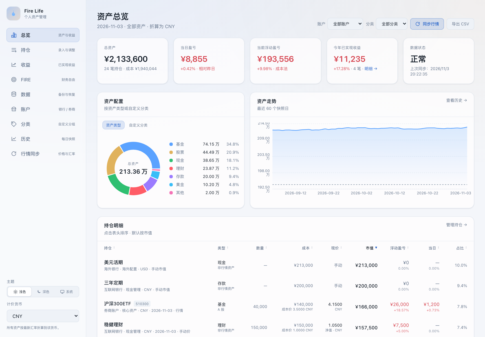
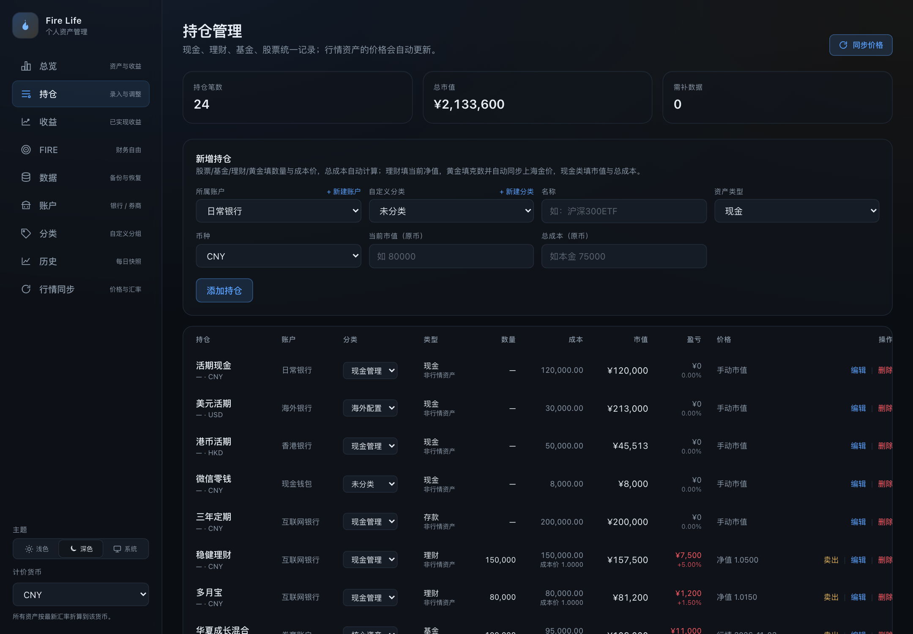
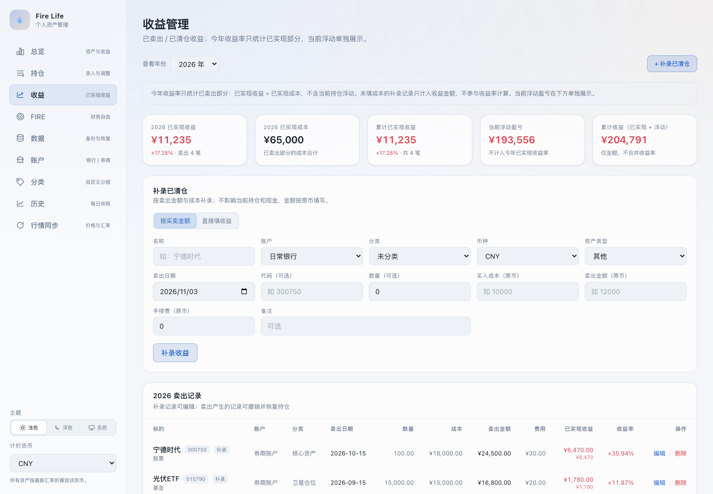
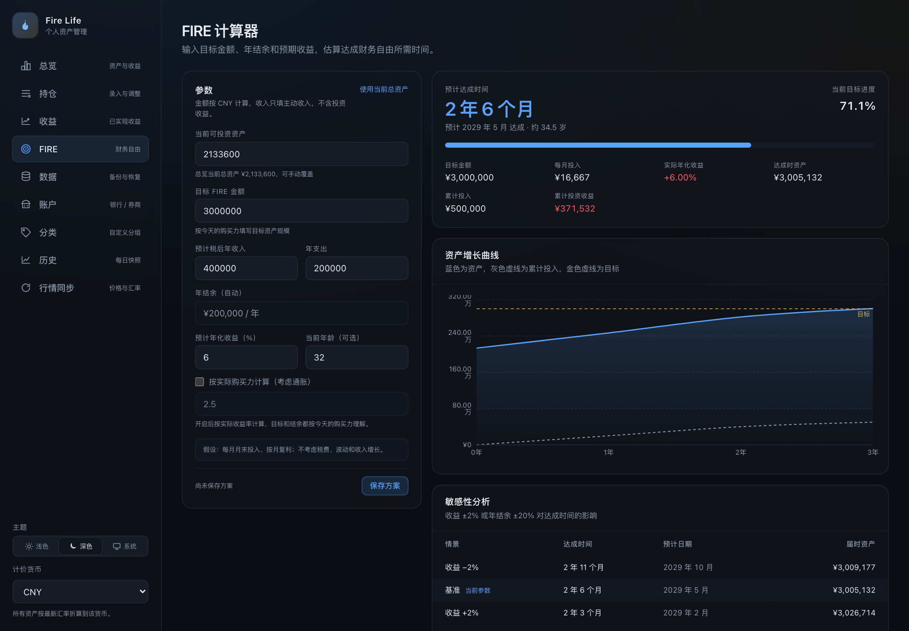
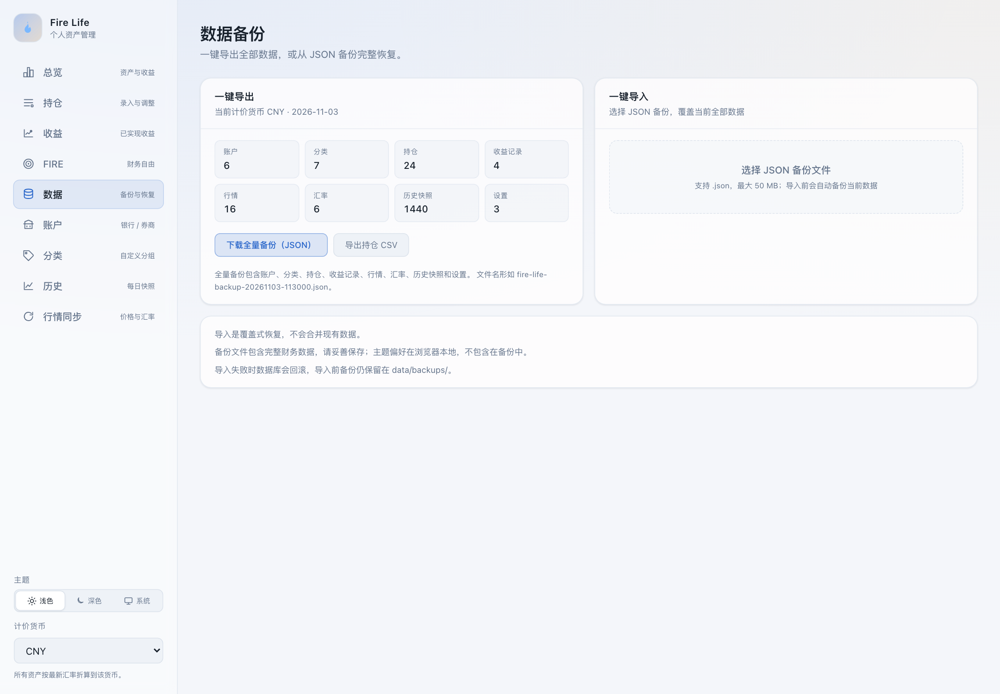

# Fire Life

> 本地优先的多账户、多币种个人资产管理工具  
> A local-first, multi-account, multi-currency personal asset dashboard.

[](https://nextjs.org)
[](https://react.dev)
[](https://www.typescriptlang.org)
[](https://www.sqlite.org)
[](#license)

Fire Life 把分散在银行、券商、海外账户里的现金、存款、理财、基金、股票、黄金放进一个本地仪表盘：每天同步行情、看资产配置和收益，并为 FIRE（财务自由）做长期规划。

数据保存在本机 SQLite 文件里，无登录、无云端、无遥测。



## 截图

| 总览（深色） | 总览（浅色） |
| --- | --- |
|  |  |
| **持仓（深色）** | **收益（浅色）** |
|  |  |
| **FIRE 计算器（深色）** | **数据备份（浅色）** |
|  |  |

## 功能

- **多账户、多币种**：银行、券商、现金钱包、海外账户统一管理
- **总览按账户 / 自定义分类联动筛选**：两个条件可叠加，KPI、配置、走势、明细和 CSV 一起过滤
- **资产类型全覆盖**：现金、存款、理财、基金、股票、黄金、其他
- **行情同步**：A 股 / 港股 / 美股 / 场外基金 / 上海金 / 汇率
- **成本与收益**：成本法、浮动盈亏、当日盈亏、已实现收益、清仓与撤销
- **收益管理**：按年份查看已实现收益，支持直接填收益或按成本 + 卖出金额补录
- **自定义分类**：给持仓打分类，资产配置饼图可在资产类型和自定义分类之间切换
- **历史快照**：每日资产曲线、年度明细、持仓排序
- **FIRE 计算器**：目标金额、年收入、年支出、年化收益、通胀开关，按月复利估算达成时间；方案可保存到本地数据库，随 JSON 备份恢复
- **主题**：浅色 / 深色 / 跟随系统
- **数据备份**：全量 JSON 导出、覆盖式导入、导入前自动备份
- **CSV 导出**：持仓明细可导出为 CSV

## 技术栈

- [Next.js 16](https://nextjs.org) App Router + React 19 + TypeScript
- [Tailwind CSS v4](https://tailwindcss.com)
- [SQLite](https://www.sqlite.org) + [better-sqlite3](https://github.com/WiseLibs/better-sqlite3) + [Drizzle ORM](https://orm.drizzle.team)
- [Recharts](https://recharts.org) 图表
- [Zod](https://zod.dev) 数据校验
- [Vitest](https://vitest.dev) 测试

## 快速开始

要求：Node.js 20+、pnpm 10+。

```bash
git clone <your-repo-url>
cd fire-life
pnpm install
pnpm db:reset
pnpm dev
```

打开 http://localhost:3000。`pnpm db:reset` 会生成一套虚构的演示数据（约 200 万资产），不会包含任何真实个人数据。

生产构建：

```bash
pnpm build
pnpm start
```

> 本地数据库默认位于 `data/fire-life.db`，已被 `.gitignore` 忽略。可以通过 `DATABASE_PATH` 环境变量指定其他 SQLite 文件。

## English Overview

Fire Life is a local-first personal finance dashboard for people whose assets are spread across banks, brokers, and currencies. It tracks cash, deposits, wealth products, funds, stocks, and gold in one place; syncs public market data; and supports cost-basis P&L, realized gains, custom categories, daily snapshots, a FIRE calculator with saved local plans, light/dark themes, and full JSON backup/restore.

All data stays in a local SQLite file. There is no account system, no cloud dependency, and no telemetry. Market prices are fetched from public endpoints and can be overridden manually. The overview can be filtered by account and/or custom category across KPIs, allocation, trend, holdings, and CSV export.

```bash
pnpm install
pnpm db:reset   # fictional demo data
pnpm dev
```

Tech stack: Next.js 16, React 19, TypeScript, SQLite + Drizzle, Tailwind CSS v4, Recharts. Licensed under MIT.

## 常用命令

| 命令 | 说明 |
| --- | --- |
| `pnpm dev` | 启动开发服务器 |
| `pnpm build` | 生产构建 |
| `pnpm start` | 启动生产服务 |
| `pnpm lint` | ESLint |
| `pnpm typecheck` | TypeScript 类型检查 |
| `pnpm test` | 运行 Vitest 测试 |
| `pnpm db:seed` / `pnpm demo:seed` | 清空并写入演示数据 |
| `pnpm db:reset` | 删除数据库并重新生成演示数据 |
| `pnpm db:sync` | 同步行情、汇率并写入当天快照 |

## 项目结构

```text
src/
  app/            Next.js 页面与 API Route Handlers
  components/     页面组件、图表、表单、主题
  db/            SQLite 连接、表结构、查询、演示数据、备份恢复
  lib/           估值、行情适配器、FIRE 计算、校验、格式化
scripts/
  sync.ts        命令行行情同步
docs/screenshots/ README 截图
data/            本地 SQLite 与备份（gitignored）
```

## 数据模型

- `accounts`：账户与主币种
- `categories`：自定义分类
- `holdings`：当前持仓（数量、成本、手动价/市值、清仓时间）
- `realized_trades`：已卖出/已清仓收益记录
- `prices`：行情快照
- `fx_rates`：汇率
- `valuations`：每日资产快照
- `settings`：计价货币、上次同步时间等

## 行情与汇率

- A 股 / 港股 / 美股：腾讯行情为主，东方财富兜底
- 场外基金：东方财富基金净值
- 上海金：东方财富 AU9999 / AU9995 / AUTD
- 汇率：frankfurter，失败时回退 exchangerate-api

这些是公开接口，可能限流、变更或失效。应用会保留上一次有效价格，并支持手动价兜底。

## 备份与恢复

访问「数据」页：

- **一键导出**：下载包含账户、分类、持仓、收益记录、行情、汇率、历史快照和设置的 JSON 备份
- **一键导入**：选择 JSON 后预览内容和数量，确认后覆盖式恢复
- 导入前会自动把当前数据保存到 `data/backups/pre-import-*.json`
- 导入在单个 SQLite 事务中执行，失败会回滚

备份文件包含完整财务数据，请妥善保存；主题偏好存储在浏览器 `localStorage`，不包含在备份中。

## FIRE 计算器

输入目标金额、税后年收入、年支出、预计年化收益和当前年龄。计算器按月末投入、按月复利估算达成时间，并支持：

- 可选通胀开关（按实际收益率计算）
- 年化收益 ±2%、年结余 ±20% 的敏感性分析
- 目标进度、达成日期、达成年龄、资产增长曲线、年度明细

这是简化的规划模型，不考虑税费、波动、收入增长和具体投资路径。

## 隐私与安全

- 所有数据保存在本地 SQLite
- 无账号体系、无云端同步、无遥测
- 除行情/汇率请求外不向外部发送数据
- 备份文件包含敏感财务信息，不要提交到公开仓库
- 应用没有鉴权，请勿直接暴露到公网

## 已知限制

- 不接入银行/券商 API，持仓与流水以手动录入为主
- 单用户、单机 SQLite，无多设备同步
- 行情为公开接口，非实时、可能失效
- 成本法按平均成本，不考虑税务批次（FIFO/指定批次）
- FIRE 计算为简化模型，不构成投资建议
- 暂无完整交易流水 / TWR / XIRR

## Roadmap

- 券商 CSV 导入与交易流水
- TWR / XIRR 收益口径
- 加密备份与可选访问密码
- 更多行情源与多设备同步
- PWA / 移动端体验

## 贡献

欢迎 Issue 和 Pull Request。提交前请运行：

```bash
pnpm lint
pnpm typecheck
pnpm test
pnpm build
```

演示数据是虚构的；请勿提交任何真实个人财务数据、数据库文件或备份文件。

## License

[MIT](LICENSE) © Fire Life contributors

## 免责声明

本项目仅用于个人资产记录与学习，不构成投资、税务或法律建议。行情数据来自第三方公开接口，可能存在延迟、错误或中断。使用本项目造成的任何损失由使用者自行承担。
